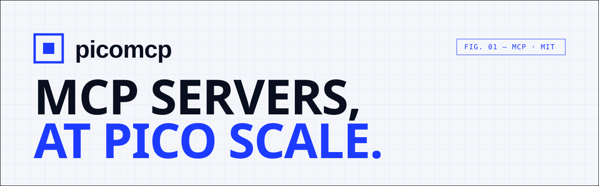

<picture>
  <source media="(prefers-color-scheme: dark)" srcset=".github/assets/banner-dark.svg">
  
</picture>

<p>
  <a href="https://www.npmjs.com/package/picomcp"></a>
  <a href="https://jsr.io/@picomcp/picomcp"></a>
  <a href="https://github.com/picomcp/picomcp/actions/workflows/ci.yml"></a>
  
  
  <a href="LICENSE"></a>
</p>

**picomcp** is a zero-dependency TypeScript framework for [Model Context Protocol](https://modelcontextprotocol.io) servers. Give any LLM real tools in one file: typed with your schema library, served over stdio or HTTP, running on Node, Bun, Deno and the edge.

```ts
import { pico } from "picomcp";
import { z } from "zod";

pico({ name: "weather" })
  .tool("forecast", {
    description: "Get the forecast for a city.",
    input: z.object({ city: z.string() }),
    run: ({ city }) => getForecast(city),
  })
  .serve();
```

That is a complete server. **[Read the docs →](https://picomcp.github.io/picomcp/docs/)**

## Why picomcp

|  |  |
| --- | --- |
| **3.9 kB gzipped, 0 dependencies** | Small enough to read in one sitting and to audit in one review. A size budget in CI keeps it that way. |
| **Typed from your schema** | Zod 4, ArkType and Valibot through [Standard Schema](https://standardschema.dev). Typed handlers, generated JSON Schema, readable validation errors the model can act on. |
| **Runs anywhere** | Node 22+, Bun, Deno, Cloudflare Workers. The core uses Web APIs only: no Node built-ins. |
| **stdio and Streamable HTTP** | Same server, one option apart. Plus a Web-standard `fetch` handler for Hono, Next.js, Workers and friends. |
| **Testable without a client** | `server.call("forecast", { city: "Lyon" })` runs a tool in-process, with type-checked names and arguments. |
| **Verified against the official SDK** | The test suite drives picomcp with `@modelcontextprotocol/sdk` over both transports. |

## Install

```sh
npm i picomcp zod        # or: bun add · pnpm add · deno add npm:picomcp
```

Or scaffold a project with a server, an entry point and a test:

```sh
npx picomcp init my-server
```

## A tour in five snippets

**Tools** are functions the model calls. Return a string, an object, media, or throw:

```ts
server.tool("search_issues", {
  description: "Search open issues. Use it before filing a new one.",
  input: z.object({ query: z.string(), limit: z.number().max(50).default(10) }),
  annotations: { readOnlyHint: true },
  run: async ({ query, limit }, { signal }) => searchIssues(query, limit, { signal }),
});
```

**Structured output** is validated and sent as `structuredContent`:

```ts
server.tool("get_price", {
  input: z.object({ sku: z.string() }),
  output: z.object({ cents: z.number().int(), currency: z.literal("EUR") }),
  run: async ({ sku }) => ({ cents: await priceOf(sku), currency: "EUR" }),
});
```

**Resources** use URI templates whose variables are typed from the string:

```ts
server.resource("github://{owner}/{repo}/readme", {
  mimeType: "text/markdown",
  read: ({ owner, repo }) => fetchReadme(owner, repo), // owner: string, repo: string
});
```

**Prompts** become slash commands in clients:

```ts
server.prompt("review", {
  args: z.object({ diff: z.string().describe("The diff to review") }),
  run: ({ diff }) => `Review this diff for bugs:\n\n${diff}`,
});
```

**Transports** are one line each:

```ts
await server.serve();                        // stdio, for local clients
await server.serve({ http: 3000 });          // Streamable HTTP on Node, Bun or Deno
export default { fetch: server.fetch };      // Cloudflare Workers, Deno Deploy, Bun…
```

## Connect a client

```sh
claude mcp add weather -- node /absolute/path/server.ts                     # Claude Code, stdio
claude mcp add --transport http weather https://example.com/mcp             # Claude Code, HTTP
npx @modelcontextprotocol/inspector node /absolute/path/server.ts           # MCP Inspector
```

Claude Desktop, Cursor and VS Code configs are in [Connect a client](https://picomcp.github.io/picomcp/docs/clients).

## Test it

```ts
import { expect, it } from "vitest";
import { server } from "./server.ts";

it("forecasts", async () => {
  const result = await server.call("forecast", { city: "Lyon" });
  expect(result.isError).toBeUndefined();
});
```

## Docs for humans and agents

The [documentation](https://picomcp.github.io/picomcp/docs/) has typo-tolerant search on <kbd>⌘</kbd> <kbd>K</kbd>, and every page is also published for AI agents:

- [`llms.txt`](https://picomcp.github.io/picomcp/llms.txt): an index of every page
- [`llms-full.txt`](https://picomcp.github.io/picomcp/llms-full.txt): the whole documentation in one file
- `docs/<page>.md`: any page as Markdown
- [`examples/docs-server.ts`](examples/docs-server.ts): the docs as an MCP server, built with picomcp

## Scope

picomcp is the server half of MCP, built for the stateless request/response model that most servers need. It covers lifecycle, tools (with structured output and annotations), resources and templates, prompts, cancellation and both transports.

It does not yet support features that need the server to message the client on its own: sampling, elicitation, roots, logging and progress notifications, subscriptions. If you need those today, use the official [`@modelcontextprotocol/sdk`](https://github.com/modelcontextprotocol/typescript-sdk). The full list is in [Protocol coverage](https://picomcp.github.io/picomcp/docs/protocol).

## Contributing

Issues and pull requests are welcome. Read [CONTRIBUTING.md](CONTRIBUTING.md) first, then:

```sh
git clone https://github.com/picomcp/picomcp && cd picomcp
npm install
npm run check    # typecheck, tests, build, size budget, package lint
```

Working with a coding agent? It will find its instructions in [AGENTS.md](AGENTS.md).

## License

[MIT](LICENSE)
